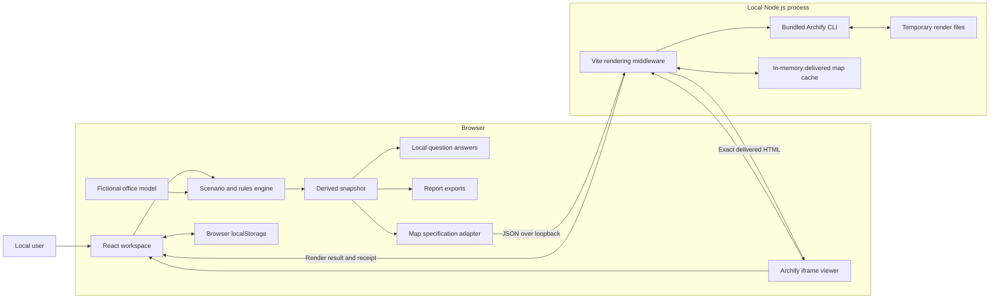
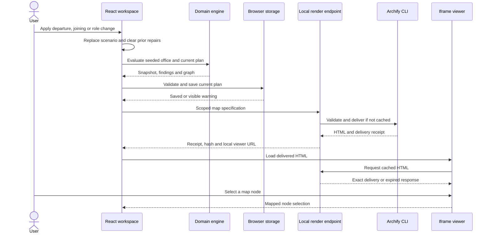
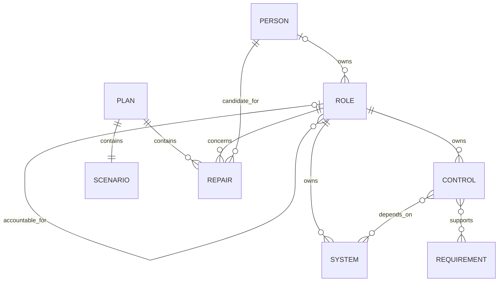

# System Architecture — Mandate

## Overview

Mandate is a local GRC impact planning application for a fictional small office. It connects people, responsibilities, systems, controls and requirements so that a user can explore what changes when someone leaves, joins or changes role. Its main output is an explainable plan: which responsibilities have lost an owner, who remains accountable, which handovers are possible, and which evidence gaps still need attention.

The application is a React and TypeScript client with a small Node.js rendering service installed as Vite middleware. The client evaluates the office model and stores the current plan in browser storage. The local service uses the bundled Archify renderer to produce the interactive map. There are no company system integrations, hosted database, user accounts or paid AI calls. “Self-healing” means proposing and validating repairs to the plan; it does not mean making changes in an identity provider or assigning real authority.

## Key Requirements

### Functional requirements

- Model departures, arrivals and role changes against a preserved fictional office baseline.
- Trace ownership, accountability, system dependencies, control coverage and requirements through one consistent snapshot.
- Suggest eligible handover candidates and retain the difference between a proposal and a confirmed handover.
- Check authority against the final proposed organisation, including changes further up the accountability chain.
- Keep missing or stale control evidence visible after an ownership repair.
- Support scoped interactive maps, local question answering, baseline comparison, plan import/export and printable reports.

### Non-functional requirements

- Run locally without a paid provider or network dependency during normal application use, after dependencies have been installed.
- Keep domain calculations deterministic and testable independently of the interface and renderer.
- Treat imported files and text fields as untrusted data.
- Preserve unreadable saved data before replacing it, and make persistence failures visible.
- Avoid presenting a diagram validation result, user assertion or fictional control status as an external compliance certificate.
- Remain suitable for a small, single-user demonstration. Production capacity, availability targets and regulatory suitability are not defined.

## High-Level Architecture

The browser owns the active plan and all GRC calculations. It derives a complete snapshot from the seeded office and the current plan, then creates a smaller Archify specification for the selected responsibility or control. Only this map specification is sent to the local rendering endpoint. The renderer returns a delivery receipt and a local URL for the exact generated HTML.

The diagram separates GRC decisions from visual rendering. A failed map render does not replace the snapshot or remove its findings. Browser storage persists the plan; the server cache only retains temporary visual artefacts.

## Component Details

### Workspace and interaction layer

[App.tsx](src/App.tsx) owns the current `Plan`, page selection, baseline comparison, selected graph node, question highlights and an in-memory undo history of up to ten previous plans. [Dialogs.tsx](src/components/Dialogs.tsx) collects scenario and handover inputs; [Panels.tsx](src/components/Panels.tsx) presents findings, inspections, questions and reports.

The interface uses React 19, TypeScript and Lucide icons. It recomputes the current snapshot when the plan changes and separately retains a baseline snapshot. Applying a new scenario replaces the previous scenario and its repairs. Baseline comparison changes the view without changing the saved plan. Undo history is session state and is not included in an exported plan.

### Office model and domain engine

[seed.ts](src/domain/seed.ts) contains the fictional Northstar Studio office: seven people, eight responsibilities, four systems, six controls and five internal policy or customer commitment requirements. The vacant assurance responsibility and stale recovery-test evidence are intentional demonstration conditions. [policy-seed.ts](src/domain/policy-seed.ts) adds four policy documents, eleven provisions, a definition and nine ODRL rules; the permission-record retention rule deliberately lacks a control.

[engine.ts](src/domain/engine.ts) implements the pure `evaluateOffice(office, plan)` calculation. It derives effective people, role ownership, accountability, findings, graph nodes and edges, requirement statuses and summary counts. It does not mutate the seed or contact external systems.

The engine applies these rules:

- A departure makes the selected person inactive and vacates their baseline responsibilities.
- A move vacates the person's previous responsibilities while keeping them active. The target responsibility is a proposal, and an incumbent is not silently displaced.
- A joining scenario introduces a new candidate. Joining alone does not establish ownership or authority.
- Candidate eligibility comes from recorded ownership, deputies, eligible people or role skills. A senior title alone is not sufficient.
- Confirmed repairs are evaluated from the top of the accountability hierarchy downwards, irrespective of their order in the imported array. Changes to upstream owners therefore affect who may authorise a downstream repair.
- The authoriser must be an active owner in the configured accountability chain, and cannot be the candidate authorising their own handover. Cyclic chains cannot establish a valid approval route.
- Confirmation also requires recorded owner acceptance, authority confirmation, access confirmation and a sufficiently specific evidence reference. These are local assertions, not authenticated approvals or live access checks.

This is a **final-plan model**, not a historical approvals ledger. A confirmation that was valid against an earlier organisation may cease to be effective after an upstream change. The resulting gap remains visible instead of retaining stale authority.

### ODRL policy rules and coverage

[odrl.ts](src/domain/odrl.ts) serialises policy documents as ODRL 2.2 Sets under the [Mandate version 1 profile](docs/odrl/profile.md). Standalone duties use `obligation`; permissions and prohibitions retain their distinct meanings. The strict canonical JSON-LD reader rejects unsupported profiles, contexts, terms and constructs. It returns policy expressions without importing trusted office alignments. The profile includes machine-readable vocabulary and a [complete seeded export](docs/odrl/policies.example.jsonld).

[policy-graph.ts](src/domain/policy-graph.ts) derives control-to-requirement links from confirmed alignments and assesses assignee, target and control coverage after office dependencies are evaluated. Requirement views aggregate descendants and explicitly referenced provisions with cycle protection. Rule cards remain in the inspector and report, while requirement map nodes display coverage counts. Suggested or unmatched alignments remain unknown; the unimplemented retention control is reported from its quoted clause.

Coverage is distinct from ODRL fulfilment, permission applicability and prohibition infringement. All rule evaluations remain `not-evaluated`: neither timing nor action performance is established by an owned control or a handover. Potential opposing rules on the same party, action and target invalidate the document's coverage assessment pending review. This release has no general ODRL execution engine, AI extractor, policy editor or policy-import UI. Policies remain source-authored, so plan persistence is unchanged.

### Local question answering

[questions.ts](src/domain/questions.ts) interprets a bounded set of questions using deterministic text matching and the current snapshot. It supports departure impact, ownership gaps, candidate handovers, accountability, requirements, quoted policy-rule gaps and missing evidence. Names and role labels are normalised for case and accents.

Answers contain explanations and graph node IDs to highlight. A clear departure question can return a suggested scenario, but cannot apply it. The user must choose to apply the suggestion, which replaces the active scenario and repairs. Ambiguous or unsupported questions return clarification or supported examples. There is no language model, remote inference service or independent knowledge base.

### Map adapter and viewer

[archify-map.ts](src/domain/archify-map.ts) converts a snapshot into a bounded Archify architecture specification. A role overview shows ownership, accountability and directly owned controls; selecting a control exposes its supporting systems and requirements. GRC lenses and the affected-only filter narrow this view. The underlying snapshot and reports retain the wider office model.

Archify's visual component categories are mapped to Mandate concepts using a custom legend. For example, the renderer's database shape represents a requirement; it does not imply that Mandate has a database.

[GraphCanvas.tsx](src/components/GraphCanvas.tsx) requests a new delivery when the specification changes, clears the old delivery, and ignores responses from aborted requests. An 80 ms delay reduces redundant requests during rapid changes. The same-origin iframe loads the exact delivered HTML. A small bridge reads the viewer's semantic node identifiers and calls its public focus and navigation APIs; it does not rewrite the delivered HTML. Selection and question highlights are mapped back to Mandate node IDs, and obsolete question focus is cleared.

The full viewer URL, zoom controls and editable specification download are visual tools. A validated map establishes that Archify accepted the specification and delivery, not that an organisation's controls work.

### Local rendering service

[server/archify.mjs](server/archify.mjs) installs two endpoints in both Vite development and preview servers:

| Endpoint | Responsibility |
| --- | --- |
| `POST /api/archify/render` | Accept a bounded JSON specification, validate it and deliver a map. |
| `GET /api/archify/map/<hash>.html` | Serve an exact delivered map that remains in the process cache. |

The service serialises and hashes each specification with SHA-256. Identical completed requests reuse a cached result; identical in-flight requests share one promise. For a new specification, it creates a temporary directory, writes the input, then invokes the bundled Archify CLI with fixed `validate` and `deliver` arguments. Each child process has a 20-second timeout and a 4 MiB output buffer limit. Temporary files are removed in a `finally` block.

The result contains HTML, the delivery receipt, specification, source hash and local viewer URL. The cache retains up to twenty results and evicts the oldest inserted entry. It is process memory, not durable storage. There is no job queue, worker pool or limit on the total number of distinct concurrent render jobs.

The vendored runtime is described in [MANDATE-NOTICE.md](vendor/archify/MANDATE-NOTICE.md). Rendering uses bundled code and assets, with the renderer's update check disabled.

### Persistence and exports

[storage.ts](src/domain/storage.ts) persists only the versioned `Plan` under `mandate-grc-plan-v1` in `localStorage`. The office model remains in source, and the snapshot is recalculated. JSON plan export provides an explicit file copy; import does not replace the office model.

[report.ts](src/domain/report.ts) produces Markdown and standalone printable HTML from the snapshot. Reports include scenario metadata, baseline versus planned ownership, accountability, repair assertions, requirement sources, ODRL rule tables, evidence references and recorded check dates. The report page also exports policy expressions as ODRL JSON-LD. HTML values are escaped, and the report needs no external scripts or assets. Reports are generated and downloaded in the browser; the rendering service does not store them.

## Data Flow

### Scenario and map refresh

The same snapshot drives findings, questions, reports and the map specification. Rendering follows evaluation; it is not the source of GRC decisions. The validation and delivery steps are skipped for a cached specification.

### Proposed and confirmed handovers

Selecting a candidate records a proposed repair. The existing owner, if any, remains effective until a valid confirmation is evaluated. Confirmation records an authoriser, three explicit checks and an evidence reference. Changing material approval inputs in the dialog clears dependent confirmations so that they must be recorded again.

On each evaluation, upstream repairs settle the final accountability chain before dependent repairs are checked. A valid confirmed handover changes effective ownership. An invalid confirmation remains visible as an unresolved proposal or vacancy and does not transfer ownership. A missing independent authority route may require a decision outside this model; the application does not promise to repair every gap.

Control evidence is evaluated separately. Assigning a new owner does not refresh a stale recovery test, establish a missing customer permission or prove a system action occurred.

### Import and recovery

The file picker rejects files larger than 500 KB. The shared parser applies a stricter 200,000-character JSON limit, accepts schema version 1 only, validates known office references and reconstructs objects from an allowlist of fields. It rejects duplicate repair IDs, multiple repairs for the same role, invalid dates, unknown people or roles, and a new starter using an existing person's ID. Strings and lists are bounded, including thirty repair records and 2,000 characters per evidence reference. Imported `confirmed` labels still pass through the engine's authority and evidence checks.

If a stored plan cannot be read, the storage module preserves its exact contents under `mandate-grc-plan-v1-recovery`, using a numbered suffix when a different recovery copy already exists. It only permits replacement after preservation succeeds. If storage is unavailable, full, or unable to create a recovery copy, the interface displays a warning and retains the current work in memory; file export remains available. There is no recovery browser or automatic restoration interface.

## Data Model

The types in [types.ts](src/domain/types.ts) describe an in-memory domain model, not database tables.

| Entity | Purpose and relationships |
| --- | --- |
| `Office` | Seeded collection of people, roles, systems, controls and requirements. |
| `Person` | Identity, active state and role skills. One person can own several responsibilities. |
| `Role` | Responsibility with an optional owner, deputies, eligible people and an optional accountable parent role. |
| `System` | Modelled system assigned to an owning role; no live connector or credentials. |
| `Control` | Activity owned by a role, linked to systems and requirements, with embedded evidence status, reference and check date. |
| `Requirement` | Internal policy or customer commitment with its recorded reference. |
| `Plan` | Schema version, one scenario and at most one repair per role after import validation. This is the persisted unit. |
| `Scenario` | Baseline, departure, joining or move, with the relevant person, target role or new-starter record. |
| `Repair` | Proposed or confirmed candidate handover, authoriser, assertions and evidence reference. |
| `Snapshot` | Derived effective state, graph, role impacts, findings, requirement impacts and summary. Rebuilt from office and plan. |

The diagram shows conceptual relationships, including optional ownership and the accountability hierarchy. A repair also references an authorising person when recorded. One plan can hold only one repair for a given role; the diagram does not imply a persisted history of earlier repairs.

Statuses are `covered`, `at-risk`, `unowned`, `proposed`, `verified`, `unknown` and `inactive`. A requirement aggregates its supporting controls: ownership risk dominates, then pending proposals, then unknown evidence. A requirement with no supporting controls is unknown. “Covered” and “verified” describe this scoped model; “verified in plan” records a handover that passes local rules. Neither status represents independent assurance. Evidence dates are recorded metadata, not proof that evidence was inspected by the application. Freshness uses the recorded `current`, `missing` or `stale` flag; the engine does not automatically age evidence based on its check date.

Graph IDs use `p:`, `r:`, `s:`, `c:` and `q:` prefixes for people, responsibilities, systems, controls and requirements. The map adapter supplies a reversible lookup between these IDs and Archify-safe identifiers.

## Infrastructure & Deployment

The current supported topology is one browser and one local Node.js process on the same machine. Dependencies and scripts are defined in [package.json](package.json); the Vite integration is in [vite.config.ts](vite.config.ts).

| Mode | Current behaviour |
| --- | --- |
| Development | `npm run dev` starts Vite bound to `127.0.0.1`, including the renderer middleware. |
| Local launcher | `npm start` uses [start-local.mjs](scripts/start-local.mjs), starts or reuses the local Mandate server on port 4173, and opens the browser. A macOS command launcher is also included. |
| Build | `npm run build` checks TypeScript and creates the client bundle in `dist`. |
| Build preview | `npm run preview` serves the built client on loopback with the same renderer middleware. |

A static upload of `dist` alone is insufficient for the interactive map because `/api/archify/render` and its process-local artefact URLs require the Node.js middleware and bundled runtime. Preview is a way to inspect the build, not a defined production deployment.

There is no configured staging environment, hosted production service, container orchestration, cloud provider or infrastructure-as-code. Initial dependency installation may require network access. Normal local planning and rendering do not require an account, API key or remote provider. Plans are scoped to the browser origin: changing hostname, port, browser profile or device can make a different saved plan visible.

## Scalability & Reliability

The engine works on a small, fixed office model in the browser. Derived snapshots are memoised for the current plan. The map is intentionally scoped to a responsibility or control rather than rendering every record at once. No large-organisation performance target or concurrent-user capacity has been established.

Renderer limits are twenty cached deliveries, twenty-four components, forty-eight connections, six explanation cards and twelve items per card. The HTTP body limit is 256 KiB. Cache reuse and in-flight deduplication reduce repeated work, but distinct requests can still create concurrent subprocesses. There is no global back-pressure, rate limiting, retry queue, horizontal scaling or service-level objective.

Failure behaviour is explicit:

- A render error shows an error state while the scenario, inspector and findings remain usable.
- A stale browser request is aborted and its result ignored; this does not guarantee cancellation of a render already running on the server.
- A server restart or cache eviction expires a full-viewer URL. The map must be requested again from the application; these URLs are not durable share links.
- A storage failure leaves work open in memory and prompts export. Browser storage can still be cleared by the user or browser and is not a backup service.
- Temporary render files are removed after success or failure. There is no durable render job recovery after process termination.

No redundant deployment or central conflict resolution exists. Multiple tabs can overwrite the same origin's saved plan; there is no collaboration protocol or cross-tab merge.

## Security & Compliance

### Trust boundaries and input handling

The loopback binding is the deployment boundary for this MVP. The render endpoint accepts JSON POST requests and, when an `Origin` header is present, requires its host and port to match the request `Host`. Requests without an `Origin` header are permitted. This check is not authentication and does not turn the endpoint into a production access-control boundary.

The service rejects map options for file outputs, repository inspection, remote brand references and filesystem source links. It invokes a fixed bundled executable through `execFile`, using temporary paths generated by the service rather than user-selected command arguments. Archify performs specification validation before delivery. Input size and subprocess limits constrain individual requests, but are not a complete defence against an untrusted shared deployment.

Imported plans are reconstructed from allowed fields rather than merged into application objects. Reports escape supplied text. The bundled renderer escapes display strings and embedded data when generating its HTML. The viewer is deliberately same-origin and is not isolated by an iframe sandbox, because the application reads semantic node attributes and uses its runtime API. Its generated content and bundled renderer therefore form part of the trusted application code. A public deployment would need a separate threat assessment and a deliberate isolation policy.

### Identity, storage and evidence

There is no login, authenticated authoriser, role-based application access, encryption layer managed by Mandate or secret store. Browser storage and downloaded plans/reports are readable to anyone with suitable access to the browser profile or files. The local endpoint uses HTTP over loopback; TLS is not configured. The seeded data is fictional and this version is not designed as a repository for sensitive employee records or credentials.

Selecting an authoriser and confirming checks records a user's assertions. Mandate does not obtain that person's consent, verify their identity, inspect a ticket, revoke access or fetch external evidence. Evidence references are text records. The report exposes these limitations alongside open gaps.

The sample requirements are internal policies and customer commitments. No formal regulatory framework mapping, legal applicability decision, compliance certification or independent audit is implemented. A visually validated Archify delivery and a locally valid plan establish different things, and neither establishes real-world compliance.

### Licensing

The repository does not currently contain a root application licence, so the intended licence for Mandate's own code is not specified here. The bundled Archify runtime retains its [MIT licence](vendor/archify/LICENSE), [third-party notices](vendor/archify/THIRD_PARTY_NOTICES.md) and [font licence](vendor/archify/assets/JetBrainsMono-OFL.txt). Those notices do not establish a licence for the rest of the application.

## Observability

Operational feedback is local and limited. The UI exposes persistence warnings, import errors, render failures, unresolved findings and evidence explanations. The renderer returns validation diagnostics where available and a delivery receipt on success. Its source hash identifies the serialised map specification; it is not a signature over the plan or evidence.

There is no central logging service, telemetry collector, metrics dashboard, distributed tracing, alerting pipeline or immutable activity log. The in-memory undo history and browser recovery copies are recovery aids, not audit trails.

Vitest covers domain behaviour, imports, questions, reports, map generation and renderer handling. TypeScript and Vite check the build. Saved Archify specifications, receipts and visual evidence are under [docs/diagrams](docs/diagrams); the scope and limits of the completed automated and browser checks are recorded in [verification.md](docs/verification.md). These checks use fictional data and synthetic assertions, and do not constitute production or regulatory acceptance.

## Trade-offs & Decisions

| Decision | Benefit | Cost or boundary |
| --- | --- | --- |
| Pure browser domain engine | One explainable calculation feeds every view and can be tested without a server. | No server-enforced integrity or shared organisation state. |
| Fixed fictional office | Makes a small, reproducible demonstration possible without handling company data. | Office editing and organisation-specific policy ingestion are absent. |
| Final-plan authority validation | Prevents a downstream repair from relying on authority removed elsewhere in the same plan. | It is not a chronological workflow or signed approvals ledger. |
| Explicit proposals and separate evidence | Makes unresolved ownership and stale evidence visible. | A user must record assertions, and some gaps cannot be resolved within the seeded authority model. |
| Deterministic local questions | No provider cost, credentials or unsupported generated claims. | Vocabulary and question coverage are deliberately limited. |
| Scoped Archify deliveries | Provides a validated, explorable viewer with standalone HTML and traceable artefacts. | Requires a local Node.js rendering step; a scoped view does not display every dependency simultaneously. |
| Browser plan storage plus file exports | Simple local persistence without accounts or a database. | No durable central backup, collaboration, access control or automatic conflict handling. |
| Ephemeral rendering cache | Reuses repeated maps without retaining a permanent server-side store. | Viewer links expire and do not survive a restart. |

## Future Improvements

These are possible next steps, not implemented features or delivery commitments:

- Add office and policy editing, authenticated provenance and versioned migration rules before importing real organisation data.
- Introduce authenticated users and independently accepted handovers, with an append-only history distinct from the final-plan model.
- Connect evidence to controlled repositories with access checks, retention rules, provenance and explicit freshness policies.
- Add approved HR and identity-system connectors only with a clear separation between simulation, approval and execution.
- Define a production deployment and threat model, including TLS, server-side authorisation, secure persistence, renderer isolation and request limits.
- Add a bounded render queue, cancellation and measurements before increasing organisation size or supporting concurrent users.
- Provide durable artefact storage and explicit sharing permissions if reports or viewers need stable links.
- Add multi-scenario comparison, cross-tab conflict handling and a recovery interface for preserved unreadable plans.
- Extend accessibility and mobile acceptance testing, and measure map readability on larger models.
- Define operational monitoring, backup recovery objectives and an application licence before offering a hosted service.
