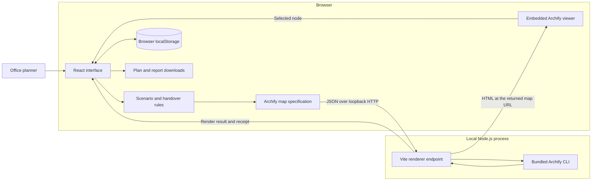
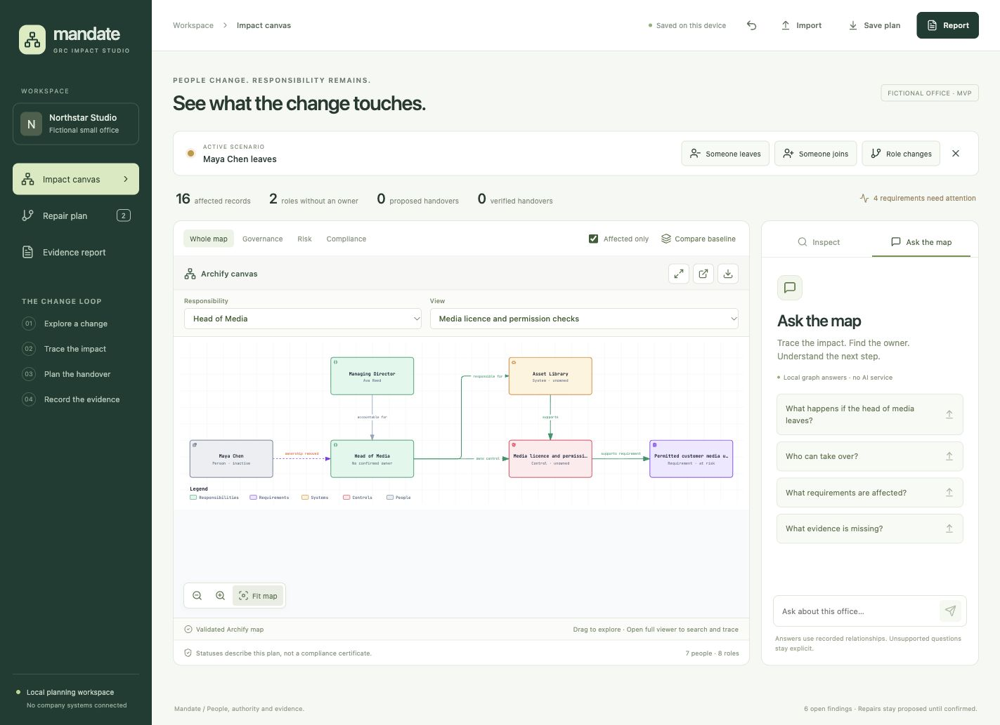
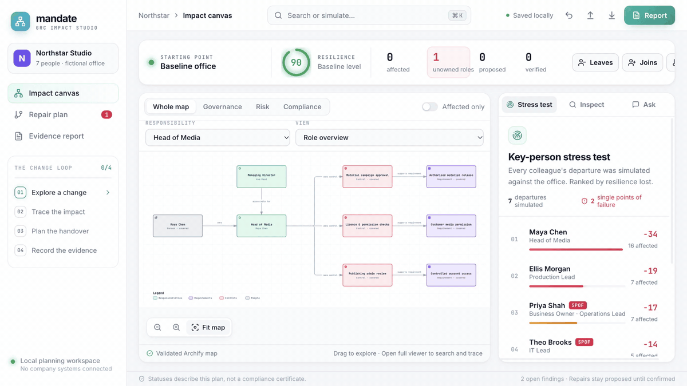
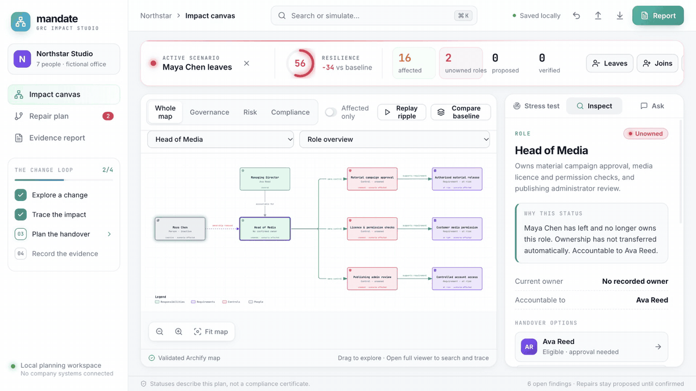

# Mandate — GRC impact canvas

See how people changes affect responsibility, risk and compliance evidence.

**Local MVP · Fictional office data · No paid AI service required**

## Description

When a department head leaves, their responsibilities remain. Approvals can stall, security controls can be left without an owner, and the disruption can affect other teams too.

We're designing a visual governance, risk and compliance canvas for small offices. It connects people, responsibilities, systems and requirements in one interactive map.

Ask the assistant what would happen if the head of media left. The canvas highlights affected decisions, explains the dependencies and shows who remains accountable.

The graph suggests suitable handovers and flags gaps for an authorised manager to resolve. Proposed changes stay pending until ownership and the required evidence are confirmed.

The same approach works when someone joins or changes role. A report shows what's covered, what needs action and why. Small teams can use it to understand the effects of a change, keep responsibilities covered and show what they've actually verified.

The supplied **Northstar Studio** office is fictional: the app does not revoke access, contact colleagues, inspect external evidence or certify compliance.

## Table of Contents

- [Description](#description)
- [Features](#features)
- [Tech Stack](#tech-stack)
- [Architecture Overview](#architecture-overview)
- [Installation](#installation)
- [Usage](#usage)
- [Configuration](#configuration)
- [Screenshots / Demo](#screenshots--demo)
- [API / CLI Reference](#api--cli-reference)
- [Tests](#tests)
- [Roadmap](#roadmap)
- [Contributing](#contributing)
- [License](#license)
- [Contact / Support](#contact--support)

## Features

- **Interactive Archify canvas:** responsibility overviews and control details, node inspection, zoom/pan, search and route tracing in the full viewer.
- **Join, move and leave scenarios:** highlight affected records and compare with the original office.
- **Governance and ownership checks:** trace configured accountability, identify available deputies and show unresolved approval gaps.
- **Self-healing plans:** propose handovers; confirmation requires an eligible owner, an independent authorised decision-maker, acceptance, authority, readiness and an evidence reference.
- **Evidence-aware reporting:** distinguish coverage, pending proposals, verification recorded in the plan, missing evidence and unresolved risks. A new owner does not refresh stale control evidence.
- **Local questions:** ask about impact, ownership, candidates and evidence using rules grounded in the current graph. Hypothetical questions offer a scenario preview before changing the plan.
- **Key-person stress test:** simulates every colleague leaving, ranks them by resilience lost and flags single points of failure (a vacated role with no recorded deputy). Select a row to play that departure.
- **Resilience score:** a live 0–100 gauge (roles 40%, controls 30%, requirements 30%) with the change against baseline. A planning indicator, not a compliance rating.
- **Scenario spotlight:** running a scenario focuses every affected record on the Archify map; **Replay ripple** runs it again.
- **Command palette:** press `⌘K` / `Ctrl+K` to simulate departures, jump to any record, ask the map or switch pages.
- **Change loop tracker:** the sidebar tracks explore → trace → plan → evidence, and each step is clickable.
- **Portable records:** autosave locally, undo recent changes, import/export plans, and download HTML or Markdown reports and editable Archify JSON.

## Tech Stack

| Layer | Technology |
| --- | --- |
| Interface | React 19, TypeScript 5, CSS, Lucide icons |
| Domain logic | Deterministic TypeScript rules and a fictional office model |
| Build and local server | Vite 7 with the React plugin and a custom Node.js renderer plugin |
| Canvas | Bundled Archify architecture renderer, typed JSON and interactive HTML viewer |
| Persistence | Browser `localStorage`; JSON file import/export |
| Tests | Vitest 3; Archify validation and browser evidence |

There is no database server, cloud backend, message queue or external AI dependency. Exact dependency versions are recorded in [package-lock.json](package-lock.json).

## Architecture Overview



Scenario evaluation, questions and reports run in the browser. The local Node.js endpoint validates and renders the map, while plans persist in browser storage and can be downloaded as files. No company systems or external services are connected; see [ARCHITECTURE.md](ARCHITECTURE.md) for the data model, approval rules, boundaries and deployment limits.

## Installation

1. Install **Git, Node.js 22.12 or newer, and npm**. A modern desktop browser is recommended.
2. Clone the repository and install the locked dependencies:

   ```sh
   git clone https://github.com/w3joe/claude-cyber-hackathon.git
   cd claude-cyber-hackathon
   npm ci
   ```

3. Start the app:

   ```sh
   npm start
   ```

4. Open [http://127.0.0.1:4173/](http://127.0.0.1:4173/).

The initial dependency installation needs internet access. Normal app use and map rendering are local afterwards; no account or API key is required. On macOS, [Start Mandate.command](Start%20Mandate.command) is an alternative launcher: it installs dependencies if absent, opens the browser and reuses an existing Mandate server on port 4173.

## Usage

### Explore a department head leaving

1. Choose **Someone leaves → Maya Chen → Explore impact**.
2. Select **Head of Media** and inspect the owner gap, accountability route and affected controls.
3. Open **Repair plan** and propose Ellis, the recorded media deputy. The proposal leaves ownership unfilled.
4. Record an eligible independent decision-maker and the required handover checks and evidence reference. Confirmation changes the planning state only.
5. Open **Evidence report** and export the result. The stale recovery evidence remains visible after a valid media handover.
6. Try **Someone joins**, **Role changes**, or ask **“What happens if the head of media leaves?”** in the side panel.

### Save and compare

Use **Save plan** to download JSON and **Import** to reopen it. **Compare baseline** temporarily shows the original office without discarding the scenario. A plan holds one active scenario and its handovers; applying a new scenario replaces the previous one. **Undo last change** retains up to ten earlier plans during the current session.

Browser storage is specific to the browser and origin. `localhost`, `127.0.0.1` and different ports have separate saved plans. Export a copy before changing address, clearing browser data or moving to another device.

### Development and built preview

```sh
# Development, with a fixed local port
npm run dev -- --port 4173 --strictPort

# Compile and preview the built application
npm run build
npm run preview -- --port 4174 --strictPort
```

The preview command serves the built app at [http://127.0.0.1:4174/](http://127.0.0.1:4174/). Both server modes include the Archify endpoint. A static upload of `dist/` alone cannot render new maps; the preview server is for local checking, not a production hosting design.

## Configuration

No environment file or secret is required for the MVP.

| Setting | Location / behaviour |
| --- | --- |
| Office, roles and controls | [src/domain/seed.ts](src/domain/seed.ts); fictional baseline compiled into the app |
| Shared data types | [src/domain/types.ts](src/domain/types.ts) |
| Renderer plugin | [vite.config.ts](vite.config.ts) and [server/archify.mjs](server/archify.mjs) |
| Default launcher address | `127.0.0.1:4173` in [scripts/start-local.mjs](scripts/start-local.mjs) |
| Alternate development/preview port | Pass `--port` and `--strictPort` as shown above |
| Saved plan key | `mandate-grc-plan-v1` in browser `localStorage` |
| Archify update checks | The renderer subprocess sets `ARCHIFY_UPDATE_CHECK_DISABLED=1` |

The office is currently maintained in source, not through an organisation editor. Plan imports refer to this office model; they are not arbitrary office imports. Unreadable saved plans are preserved in separate recovery keys before replacement, and saving is blocked if a recovery copy cannot be retained.

## Screenshots / Demo

### Three-minute video

[Watch the Mandate demo on Google Drive](https://drive.google.com/file/d/1lB5UrBpmTH9w5Yjg470VEwNFIWDC7ZOa/view?usp=sharing)

The video introduces the problem through documented cases, then shows the application tracing a departure, proposing a handover, recording confirmation and reviewing the remaining evidence gaps.



The screenshot shows the fictional office with the Head of Media departure scenario running. Run the demo locally using the installation steps; **no public hosted application URL is configured in this repository**.

### Animated walkthroughs

These GIFs show real interactions in the local app with the fictional Northstar Studio office.

**Departure impact.** Select Maya in the key-person stress test. The canvas shows the Head of Media responsibility without an owner and highlights the affected controls and requirements.



**Proposed to confirmed handover.** Choose Ellis as the recorded deputy, save a proposal, then record Ava as the authorised decision-maker, the required checks and a fictional handover evidence reference. The plan then records Ellis as the owner; unrelated evidence gaps remain open.



The recorded checks are user assertions in a demonstration plan. They do not change real accounts, contact the named people or independently validate compliance evidence.

The example responsibility map includes [editable JSON](docs/diagrams/mandate-head-media.architecture.json), [standalone interactive HTML](docs/diagrams/mandate-head-media.html), a [delivery receipt](docs/diagrams/mandate-head-media.receipt.json) and [browser evidence](docs/diagrams/mandate-head-media.visual-check.html). Open the HTML locally after cloning; GitHub normally displays HTML source rather than running the viewer.

## API / CLI Reference

The renderer is an internal local endpoint, not an authenticated integration API.

| Method and path | Purpose |
| --- | --- |
| `POST /api/archify/render` | Accept `{ "specification": ... }` containing an Archify architecture map with showcase quality; return `html`, `receipt`, `specification`, `sourceHash` and `url` |
| `GET /api/archify/map/<sha256>.html` | Serve a rendered map while its entry remains in the process cache; return 404 if unavailable |

Example request from the project directory while the app is running:

```sh
node --input-type=module <<'JS'
import { readFile } from 'node:fs/promises';
const specification = JSON.parse(await readFile(
  'docs/diagrams/mandate-head-media.architecture.json', 'utf8'
));
const response = await fetch('http://127.0.0.1:4173/api/archify/render', {
  method: 'POST',
  headers: { 'Content-Type': 'application/json' },
  body: JSON.stringify({ specification })
});
if (!response.ok) throw new Error(await response.text());
const result = await response.json();
console.log(result.url);
JS
```

The POST route requires JSON, limits requests to 256 KiB and checks the request host against `Origin` when supplied. Responses include 403 for rejected origins, 405 for unsupported methods on the render route, 413 for oversized bodies, 415 for other content types and 422 for invalid JSON/specifications or render failures. These controls do not provide user authentication.

Validate the bundled example directly, without starting the app:

```sh
node vendor/archify/bin/archify.mjs validate architecture \
  docs/diagrams/mandate-head-media.architecture.json --quality showcase --json
```

## Tests

```sh
npm test                 # Run the Vitest suite once
npm run test:watch       # Watch affected tests during development
npm run build           # Type-check and produce the application bundle
```

The recorded verification on **4 November 2026** passed **70 tests across six files**, plus the production build. Tests cover scenarios, final-plan approval authority, evidence states, questions, reports, import/recovery, map projection and renderer request constraints. The example map passed all nine Archify showcase checks with zero errors or warnings; [verification notes](docs/verification.md) distinguish automated tests, browser checks and their limits.

## Roadmap

Potential next steps, not implemented commitments:

- An editable office model and versioned multi-event scenarios.
- Shared workspaces, authentication and role-based permissions.
- Durable, attributable approval history and independently checked evidence.
- Organisation-specific control libraries and reviewed HR/identity integrations.
- Broader accessibility, mobile and performance acceptance testing.

## Contributing

Open an [issue](https://github.com/w3joe/claude-cyber-hackathon/issues) to discuss a bug or proposed change. For a contribution, create a branch, keep the change focused, run the relevant tests and build, then open a [pull request](https://github.com/w3joe/claude-cyber-hackathon/pulls) describing the behaviour and validation.

Preserve the distinction between proposals, recorded verification and independent evidence. Use synthetic data in examples and tests, update the documentation when behaviour changes, and retain third-party licence notices. See the licensing status below before reusing or redistributing the application.

## License

**A project-wide licence for the Mandate application has not been declared.** There is no root `LICENSE` file; the vendored renderer’s licence should not be assumed to cover the application.

The bundled Archify runtime, based on upstream `tt-a1i/archify` version `2.17.0-dev.1`, retains its [MIT licence](vendor/archify/LICENSE), [third-party notices](vendor/archify/THIRD_PARTY_NOTICES.md), [font licence](vendor/archify/assets/JetBrainsMono-OFL.txt) and [adaptation note](vendor/archify/MANDATE-NOTICE.md).

## Contact / Support

Use the [project repository](https://github.com/w3joe/claude-cyber-hackathon) and [GitHub issues](https://github.com/w3joe/claude-cyber-hackathon/issues) for support and feedback. Include reproduction steps, expected behaviour and your Node/browser versions. Keep real company records and credentials out of public reports.
